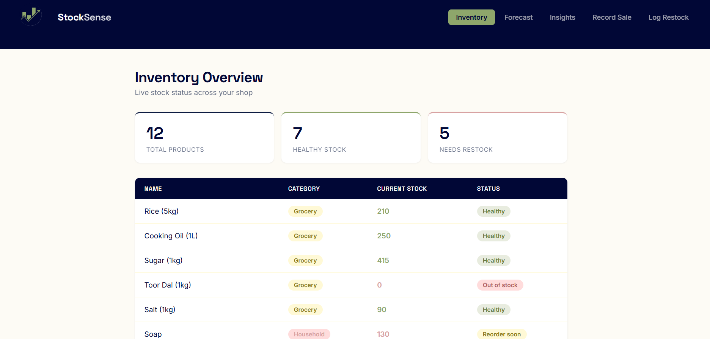
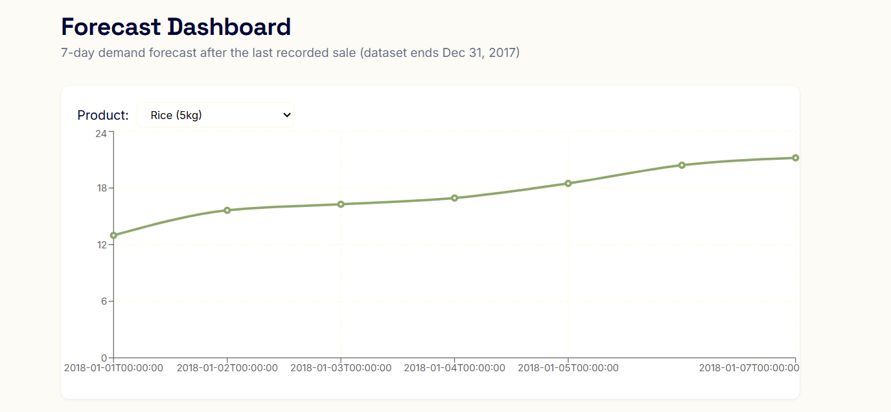

# StockSense

Inventory management for small shops, with reorder-point / EOQ optimization and Prophet-based demand forecasting.



## What it does

- **Inventory overview:** live stock per product, derived from restocks minus sales (never stored directly, so it can't drift out of sync)
- **Forecasting:** 7-day demand forecast per product using Prophet, shown as a chart
- **Insights:** units sold by category and products ranked by sales, with slow movers highlighted
- **Data entry:** log restocks and record sales, with server-side validation
- **Operations research:** reorder point and Economic Order Quantity (EOQ) as API endpoints

## Tech stack

React (Vite) · FastAPI · PostgreSQL (Docker) · Pandas · Prophet · Recharts

## Design decisions

- **Stock is derived, not stored.** `stock = SUM(restock quantity) - SUM(sold quantity)`, so the history is the single source of truth.
- **Restock and Sale are separate event tables**, with `SaleItem` holding `price_at_sale` so past sales keep their original price when prices change.
- **The server looks up prices itself** when recording a sale; the client never sends one.
- **Reorder point** = (avg daily sales x lead time) + safety stock, where safety stock = (max - avg daily sales) x lead time.
- **EOQ** = sqrt(2DS / H).

## Forecast validation



Backtested on Rice (5kg) with a held-out final 7 days: Prophet's mean absolute error was about 2.60 units against about 4.53 for a 7-day moving-average baseline. This is a single product and a single window, so treat it as an initial result rather than a general claim.

## Data

The sales history is the public Kaggle *Store Item Demand Forecasting Challenge* dataset (store 1, 12 items), relabeled with small-shop product names. The numbers are real retail data but not from an Indian shop, so seasonal patterns reflect the source dataset.
Forecast shapes look similar across products because items in the source dataset share seasonal patterns; the volumes differ.

## Running it locally

1. Start the database: `docker compose up -d`
2. Create tables: load `backend/schema.sql` into the database
3. Backend:
```
   cd backend
   python -m venv venv
   venv\Scripts\activate
   pip install -r requirements.txt
```
   Create `backend/.env` with `DB_HOST`, `DB_PORT`, `DB_NAME`, `DB_USER`, `DB_PASSWORD`, then run `uvicorn main:app --reload`
4. Optional seed data: download `train.csv` from the Kaggle competition into `backend/data/`, then run `python seed_data.py`
5. Frontend: `cd frontend`, `npm install`, `npm run dev`

## Known limitations

- Single shop, no authentication
- Prophet retrains on every forecast request (fine for a demo, would be cached in production)
- Some default IDs in the forms are tied to the demo database
- Power BI reporting layer not built
- Restock status uses average daily sales over the full history and a fixed 3-day lead time

## Possible next steps

Authentication and multi-shop support, cached/scheduled model training, cloud deployment, product and dealer management screens.